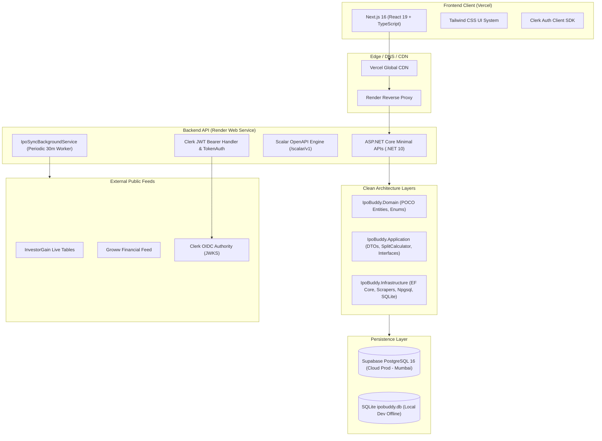
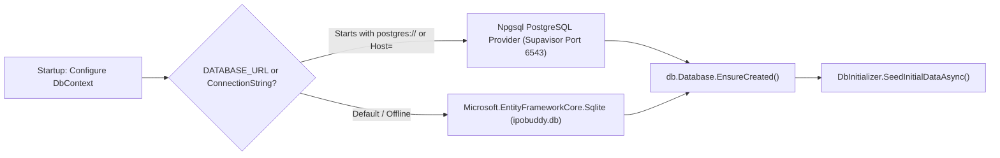
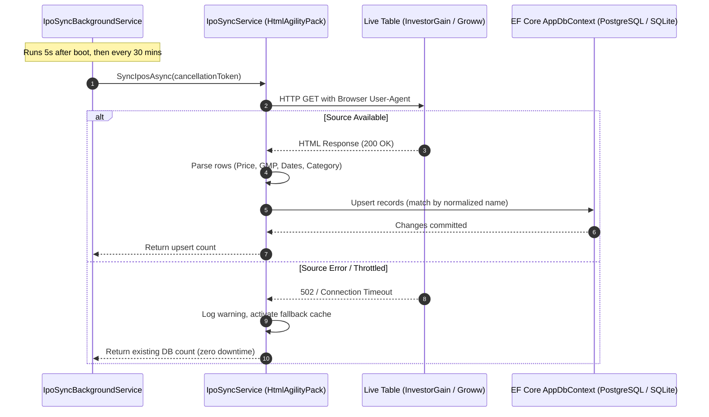
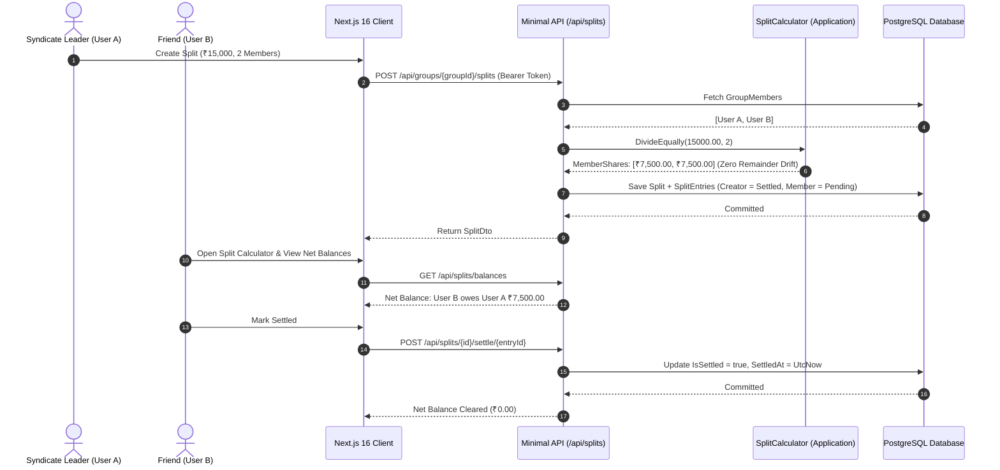

# IPO Buddy — System Architecture Document

> **Version:** 2.0  
> **Status:** Active / Production  
> **Target Framework:** .NET 10 & Next.js 16  
> **Infrastructure Mandate:** 100% Zero-Cost Free-Tier

---

## 1. System Overview

**IPO Buddy** is a centralized Indian Initial Public Offering (IPO) tracking and informal syndicate split platform. It is engineered to solve two intertwined problems for Indian retail investors:
1. Fragmented, inaccurate market intelligence (live bidding subscription levels, issue price bands, and Grey Market Premium / GMP).
2. The informal coordination problem where friends and family pool capital across accounts to maximize retail lottery allotment odds, requiring precise, audit-proof distribution of listing gains without penny rounding drift.



---

## 2. .NET 10 Clean Architecture

The backend strictly follows the Dependency Inversion Principle. Core business entities and mathematical algorithms do not depend on external frameworks, databases, or UI layers.

```
src/
├── IpoBuddy.Domain/          # Pure POCO Entities & Business Enums (Zero External Deps)
│   ├── Entities/             # User, Ipo, WatchlistItem, Group, GroupMember, Split, SplitEntry
│   └── Enums/                # IpoCategory, IpoStatus, SplitType, SplitStatus, SubscriptionTier
│
├── IpoBuddy.Application/     # Contracts, DTOs & Domain Logic
│   ├── Common/               # Zero-drift SplitCalculator (decimal precision arithmetic)
│   ├── DTOs/                 # Request/Response data transfer records
│   └── Interfaces/           # IAppDbContext, IIpoSyncService contracts
│
├── IpoBuddy.Infrastructure/  # External Services & Persistence
│   ├── Data/                 # EF Core AppDbContext, DbInitializer, Entity Configurations
│   └── Services/             # IpoSyncService (HtmlAgilityPack Scraper), IpoSyncBackgroundService
│
└── IpoBuddy.Api/             # ASP.NET Core Minimal APIs (.NET 10)
    ├── Auth/                 # Clerk JWT Bearer, ClaimsExtensions, TokenService
    ├── Endpoints/            # AuthEndpoints, IpoEndpoints, GroupEndpoints, SplitEndpoints
    └── Program.cs            # Route groups, Scalar OpenAPI, CORS, and middleware pipeline
```

### Layer Dependency Rules
- `Domain` depends on **nothing**.
- `Application` depends only on `Domain`.
- `Infrastructure` depends on `Application` and `Domain`.
- `Api` orchestrates dependencies and depends on `Infrastructure` and `Application`.

---

## 3. Database Persistence Strategy: Dual-Mode Architecture

To guarantee frictionless offline local development behind corporate proxies while deploying to a managed PostgreSQL cluster in production with $0 spend, EF Core dynamically routes connections based on environment:



### Connection Characteristics
* **Production Database:** Supabase PostgreSQL 16 hosted in AWS `ap-south-1` (Mumbai).
  * **Port:** `6543` utilizing Supavisor Transaction Pooler to support serverless connection bursts without exhausting Postgres worker threads.
  * **SSL Mode:** `Require`.
* **Local Offline Database:** SQLite (`ipobuddy.db`). Enables complete local development and testing without internet access or database server installations.

---

## 4. Frontend Architecture (Next.js 16 + React 19)

The client application is built with Next.js 16 (Turbopack) using the App Router and React 19:

```
frontend/src/
├── app/
│   ├── layout.tsx            # Global ClerkProvider wrapper & font injection
│   ├── page.tsx              # Single-page tabbed dashboard (Explorer, Watchlist, Groups, Splits, Tax)
│   └── globals.css           # Tailwind CSS v4 styling & dark theme variables
├── context/
│   └── AuthContext.tsx       # Unified authentication state & profile auto-healing
└── lib/
    └── api.ts                # Type-safe API client with automatic Clerk JWT Bearer injection
```

### Key Frontend Patterns
1. **Dynamic JWT Injection:** `api.ts` registers a reactive token getter with Clerk's `getToken()` so every outgoing REST call carries fresh authorization without stale token expiry.
2. **Self-Healing Display Names:** `AuthContext.tsx` inspects profile display names. If a raw Clerk ID (`user_...`) is detected from legacy creation, it dynamically swaps to the user's friendly name and patches the backend.
3. **Optimistic Visual State:** Tab switches, live sync triggers, and watchlist toggles execute with immediate UI feedback and non-blocking background synchronization.

---

## 5. Ingestion Pipeline & Background Workers

Market data accuracy is maintained without paid third-party financial API subscriptions ($50–$100/mo) through an autonomous ingestion pipeline:



---

## 6. End-to-End Sequence: Syndicate Gain Split



---

## 7. Infrastructure & Deployment Topology

| Component | Platform | Configuration | Monthly Cost |
| :--- | :--- | :--- | :--- |
| **Backend API** | Render | Docker Linux Container, Singapore Region, Port 8080/Dynamic | $0.00 (Free Tier) |
| **Frontend** | Vercel | Next.js 16 Turbopack, Global Edge Network | $0.00 (Hobby Tier) |
| **Database** | Supabase | PostgreSQL 16, 500 MB Storage, Mumbai `ap-south-1` | $0.00 (Free Tier) |
| **Auth Provider** | Clerk | Multi-tenant OAuth & OTP Engine (10,000 MAUs) | $0.00 (Free Tier) |
| **CI / Automation**| GitHub Actions | Parallel Matrix Workflows (.NET 10 + Node 20) | $0.00 (Public/Free Tier) |
| **Total Cost** | | | **$0.00 / month** |
