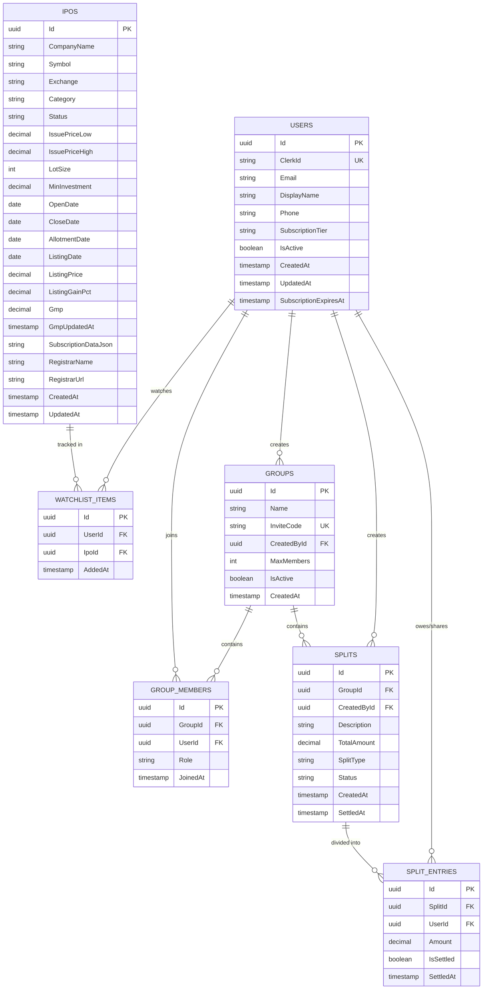

# IPO Buddy — Database Architecture & Schema Specification

> **Database Engines:** PostgreSQL 16 (Supabase Cloud) / SQLite (Local Dev)  
> **ORM:** Entity Framework Core 10 (`Microsoft.EntityFrameworkCore`)  
> **Connection Strategy:** Supavisor Transaction Pooler (`port 6543`) with SSL

---

## 1. Entity-Relationship Diagram (ERD)



---

## 2. Table Schemas & Column Definitions

### 2.1 `Users` Table
Stores registered retail investor accounts. Synchronized with Clerk OAuth on first login.

| Column | Type | Nullable | Constraints & Description |
| :--- | :--- | :--- | :--- |
| `Id` | `uuid` | No | Primary Key (`Guid.NewGuid()`) |
| `ClerkId` | `varchar(128)` | Yes | Unique index. Maps to Clerk's `sub` claim (`user_...`) |
| `Email` | `varchar(255)` | No | User's primary email address |
| `DisplayName` | `varchar(100)` | No | Human-readable name (sanitized from email or full name) |
| `Phone` | `varchar(20)` | Yes | Optional mobile number |
| `SubscriptionTier`| `varchar(20)` | No | Enum: `Free`, `Pro` (Default: `Free`) |
| `IsActive` | `boolean` | No | Account status flag (Default: `true`) |
| `CreatedAt` | `timestamp` | No | Record creation in UTC |
| `UpdatedAt` | `timestamp` | No | Last update in UTC |

### 2.2 `Ipos` Table
Core market intelligence repository containing Mainboard and SME IPO details.

| Column | Type | Nullable | Constraints & Description |
| :--- | :--- | :--- | :--- |
| `Id` | `uuid` | No | Primary Key |
| `CompanyName` | `varchar(255)` | No | Company name (Normalized, stripped of boilerplate) |
| `Symbol` | `varchar(50)` | Yes | Exchange trading ticker (e.g., `BAJAJHFL`) |
| `Exchange` | `varchar(50)` | No | `NSE`, `BSE`, `NSE SME`, `BSE SME` |
| `Category` | `varchar(20)` | No | Enum: `Mainboard`, `Sme` |
| `Status` | `varchar(20)` | No | Enum: `Upcoming`, `Open`, `Closed`, `Listed` |
| `IssuePriceLow` | `numeric(18,2)`| Yes | Lower floor of price band in ₹ |
| `IssuePriceHigh`| `numeric(18,2)`| Yes | Cap price in ₹ |
| `LotSize` | `integer` | No | Number of shares per retail bid lot |
| `MinInvestment` | `numeric(18,2)`| Yes | Minimum retail application cost (`IssuePriceHigh` $\times$ `LotSize`) |
| `OpenDate` | `date` | Yes | Bidding start date |
| `CloseDate` | `date` | Yes | Bidding deadline |
| `AllotmentDate` | `date` | Yes | Basis of allotment finalization date |
| `ListingDate` | `date` | Yes | Exchange listing date |
| `ListingPrice` | `numeric(18,2)`| Yes | Opening price on listing day in ₹ |
| `ListingGainPct`| `numeric(18,2)`| Yes | Percentage gain over issue price |
| `Gmp` | `numeric(18,2)`| Yes | Unofficial Grey Market Premium in ₹ |
| `GmpUpdatedAt` | `timestamp` | Yes | Last time GMP was refreshed |
| `SubscriptionDataJson` | `text` | Yes | JSON string containing live bidding category breakdown |
| `RegistrarName`| `varchar(150)`| Yes | e.g., `Link Intime`, `KFin Technologies`, `Bigshare` |
| `RegistrarUrl` | `varchar(255)`| Yes | Direct verification portal link |

#### Sample `SubscriptionDataJson` Payload
```json
{
  "qib": 124.5,
  "nii": 45.2,
  "retail": 8.7,
  "employee": 2.1,
  "total": 64.3,
  "updatedAt": "2026-10-14T09:30:00Z"
}
```

### 2.3 `WatchlistItems` Table
Links user profiles to tracked IPOs.

| Column | Type | Nullable | Constraints & Description |
| :--- | :--- | :--- | :--- |
| `Id` | `uuid` | No | Primary Key |
| `UserId` | `uuid` | No | FK to `Users(Id)` with `OnDelete: Cascade` |
| `IpoId` | `uuid` | No | FK to `Ipos(Id)` with `OnDelete: Cascade` |
| `AddedAt` | `timestamp` | No | UTC timestamp |

*Composite Unique Constraint:* `(UserId, IpoId)` ensures no duplicate watchlist entries.

### 2.4 `Groups` Table
Represents private friend/family syndicates.

| Column | Type | Nullable | Constraints & Description |
| :--- | :--- | :--- | :--- |
| `Id` | `uuid` | No | Primary Key |
| `Name` | `varchar(100)` | No | Syndicate display name |
| `InviteCode` | `varchar(10)` | No | Unique 6-character alphanumeric code (Index) |
| `CreatedById` | `uuid` | No | FK to `Users(Id)` |
| `MaxMembers` | `integer` | No | Syndicate limit (Default: `15`) |
| `IsActive` | `boolean` | No | Active flag |
| `CreatedAt` | `timestamp` | No | UTC timestamp |

### 2.5 `GroupMembers` Table
Membership junction table.

| Column | Type | Nullable | Constraints & Description |
| :--- | :--- | :--- | :--- |
| `Id` | `uuid` | No | Primary Key |
| `GroupId` | `uuid` | No | FK to `Groups(Id)` with `OnDelete: Cascade` |
| `UserId` | `uuid` | No | FK to `Users(Id)` with `OnDelete: Cascade` |
| `Role` | `varchar(20)` | No | `Admin`, `Member` |
| `JoinedAt` | `timestamp` | No | UTC timestamp |

### 2.6 `Splits` Table
Shared listing gain or expense event within a syndicate.

| Column | Type | Nullable | Constraints & Description |
| :--- | :--- | :--- | :--- |
| `Id` | `uuid` | No | Primary Key |
| `GroupId` | `uuid` | No | FK to `Groups(Id)` with `OnDelete: Cascade` |
| `CreatedById` | `uuid` | No | FK to `Users(Id)` |
| `Description` | `varchar(200)` | No | Event notes (e.g., *"Tata Tech Listing Gain"*) |
| `TotalAmount` | `numeric(18,2)`| No | Total divisible amount in ₹ |
| `SplitType` | `varchar(20)` | No | Enum: `Equal`, `Exact`, `Percentage` |
| `Status` | `varchar(20)` | No | Enum: `Pending`, `Settled` |
| `CreatedAt` | `timestamp` | No | UTC timestamp |
| `SettledAt` | `timestamp` | Yes | When all member entries become settled |

### 2.7 `SplitEntries` Table
Individual member obligations and allocation shares.

| Column | Type | Nullable | Constraints & Description |
| :--- | :--- | :--- | :--- |
| `Id` | `uuid` | No | Primary Key |
| `SplitId` | `uuid` | No | FK to `Splits(Id)` with `OnDelete: Cascade` |
| `UserId` | `uuid` | No | FK to `Users(Id)` |
| `Amount` | `numeric(18,2)`| No | Member's calculated share in ₹ |
| `IsSettled` | `boolean` | No | True if member has settled this entry |
| `SettledAt` | `timestamp` | Yes | UTC timestamp of settlement toggle |

---

## 3. Database Indexes & Query Optimization

```sql
-- Indexes for fast lookup
CREATE INDEX IX_Ipos_Status ON "Ipos" ("Status");
CREATE INDEX IX_Ipos_Category ON "Ipos" ("Category");
CREATE INDEX IX_Ipos_CompanyName ON "Ipos" ("CompanyName");
CREATE UNIQUE INDEX IX_Groups_InviteCode ON "Groups" ("InviteCode");
CREATE UNIQUE INDEX IX_Users_ClerkId ON "Users" ("ClerkId");
CREATE UNIQUE INDEX IX_Watchlist_User_Ipo ON "WatchlistItems" ("UserId", "IpoId");
CREATE INDEX IX_SplitEntries_User_Settled ON "SplitEntries" ("UserId", "IsSettled");
```

---

## 4. Dual-Mode Database Connection Configuration

In `src/IpoBuddy.Infrastructure/DependencyInjection.cs`:
* If connection string starts with `postgres://` or `postgresql://` (or `Host=`):
  Parses URL, configures `Npgsql.EntityFrameworkCore.PostgreSQL`, sets port `6543`, and enforces `SslMode.Require`.
* If connection string is missing or local default:
  Configures `Microsoft.EntityFrameworkCore.Sqlite` targeting local file `ipobuddy.db`.
* On startup, `db.Database.EnsureCreated()` guarantees schema presence without requiring manual migration scripts on ephemeral free-tier cloud instances.
