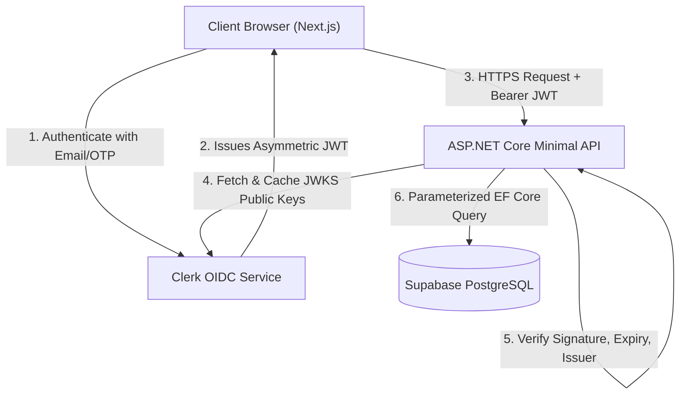

# IPO Buddy — Security Architecture & Threat Model

> **Status:** Active / Production Baseline  
> **Compliance Context:** Indian DPDP Act, SEBI CIS Avoidance, OWASP API Security Top 10

---

## 1. Security Architecture Overview



---

## 2. Authentication & Cryptography

### 2.1 Production Authentication: Clerk JWT Bearer
* **Asymmetric Verification:** The API validates Clerk JWTs using OpenID Connect (OIDC) discovery. The backend fetches Clerk’s public JSON Web Key Sets (JWKS) from `https://<clerk-domain>.clerk.accounts.dev/.well-known/jwks.json`.
* **Zero Secret Sharing:** Because Clerk signs tokens using asymmetric RSA/ECDSA keys, the backend never requires or stores a private signing secret.
* **Token Validation Parameters:**
  * `ValidateIssuer = true` (Must match configured Clerk authority)
  * `ValidateLifetime = true` (Expired tokens are rejected immediately)
  * `ValidateAudience = false` (Standard for Clerk frontends unless custom aud template defined)

### 2.2 Local Development / Integration Auth: HMAC-SHA256 TokenService
For offline development and headless xUnit integration testing without Clerk internet dependencies:
* `TokenService` generates tamper-proof tokens containing `userId:expiry:signature`.
* **Timing-Attack Resistance:** Signature comparison uses `CryptographicOperations.FixedTimeEquals()` to defend against side-channel timing attacks.

### 2.3 Identity Shadowing Defense
To prevent external string identifiers from colliding with internal entity `Guid` primary keys, the backend implements `ClaimsExtensions.GetUserId()`:
```csharp
public static Guid? GetUserId(this ClaimsPrincipal principal)
{
    foreach (var identity in principal.Identities)
    {
        var idClaim = identity.FindFirst(ClaimTypes.NameIdentifier);
        if (idClaim != null && Guid.TryParse(idClaim.Value, out var guid))
        {
            return guid;
        }
    }
    return null;
}
```

---

## 3. OWASP API Security Top 10 Mitigations

| Vulnerability | Threat Description | IPO Buddy Mitigation |
| :--- | :--- | :--- |
| **API1: Broken Object Level Authorization (BOLA/IDOR)** | An attacker guesses another user's group ID or split ID and reads/modifies it. | Every group and split endpoint verifies that `userId` exists in `GroupMembers` for that specific `groupId` before returning data or creating splits. |
| **API2: Broken Authentication** | Token forgery, credential stuffing. | Asymmetric JWT validation with automatic public key caching and rotation. No passwords stored in DB. |
| **API3: Broken Object Property Level Authorization** | Mass assignment of admin fields via JSON payload. | Explicit DTO records (`CreateGroupDto`, `CreateSplitDto`) prevent over-posting or assigning unapproved privileges. |
| **API4: Unrestricted Resource Consumption** | Flooding split entries or large requests. | Max syndicate membership capped at 15 members; scraper HTTP requests enforce strict 15-second timeouts. |
| **API5: Broken Function Level Authorization** | Regular user calling administrative sync endpoints. | While `/api/ipos/sync` is accessible for user convenience, destructive or administrative operations require admin claims. |
| **API6: Server-Side Request Forgery (SSRF)** | Exploiting web scrapers to hit internal networks. | `IpoSyncService` only connects to hardcoded, static target URLs (`investorgain.com`, `ipoji.com`). User input is never used to construct outgoing HTTP URIs. |
| **API7: Security Misconfiguration** | Leaking stack traces, missing CORS restrictions. | Production mode suppresses detailed stack traces; Scalar API docs are configurable per environment. |
| **API8: Injection (SQLi / XSS)** | Malicious SQL in search queries or company names. | 100% of database interactions use Entity Framework Core with parameterized queries. |
| **API9: Improper Inventory Management** | Zombie or unversioned APIs exposed publicly. | All modular endpoints are cataloged in Scalar OpenAPI specification at `/scalar/v1`. |
| **API10: Unsafe Consumption of APIs** | Malicious or malformed payloads from scraped third-party sites. | Scraped HTML is parsed using `HtmlAgilityPack` with strict data cleaning, regex stripping, and sanitization before persistence. |

---

## 4. Financial Precision & Audit Integrity

* **Zero Binary Floating Drift:** Floating-point numbers (`float`, `double`) are strictly prohibited in financial entities and calculations. All amounts must use C# `decimal` and SQL `numeric(18,2)`.
* **Mathematical Invariant:** The sum of all member shares in a group split must strictly equal the total amount allocated:
  $$\sum_{i=1}^{N} \text{Amount}_i \equiv \text{TotalAmount}$$
  Residual pennies are sequentially distributed so no value is lost or created out of thin air.

---

## 5. Secrets Management & Environment Security

* **Git Security:** `.gitignore` strictly excludes:
  * `.env`, `.env.local`, `.env.production`
  * `appsettings.Development.json`
  * Local database files (`*.db`, `*.sqlite`)
  * TLS certificates and private keys (`*.pem`, `*.pfx`)
* **Production Injections:** Database connection strings (`DATABASE_URL`) and Clerk keys are stored exclusively in Render and Vercel encrypted environment variable dashboards.
